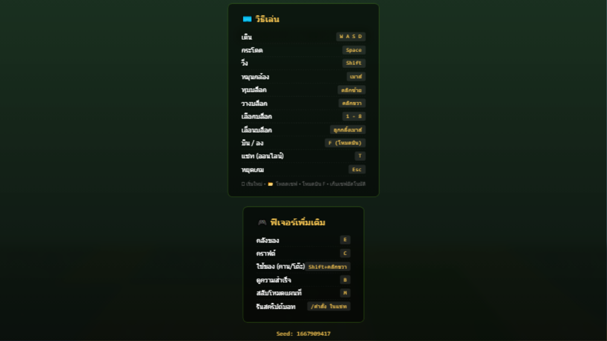
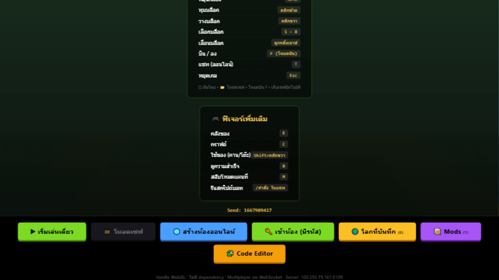
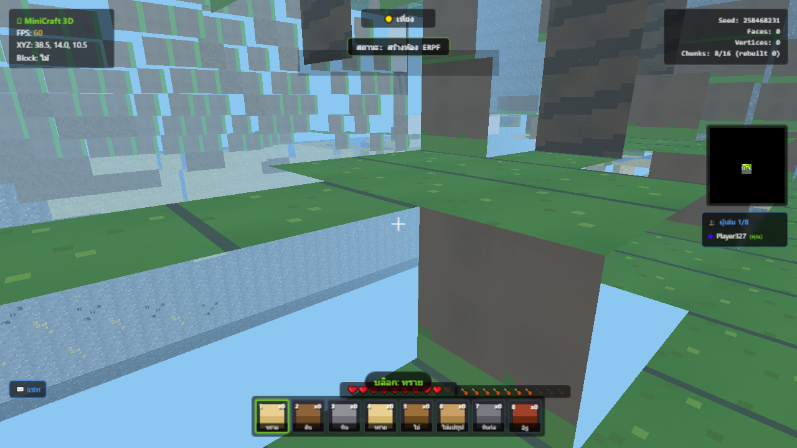
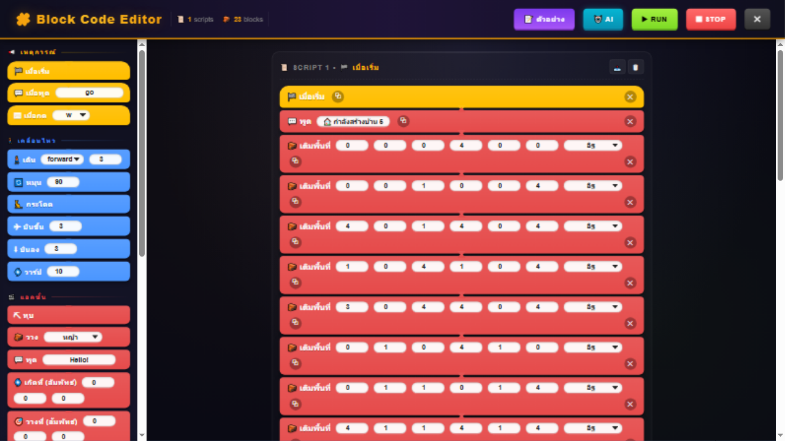

# 🎮 SJ88 Block Code Creater — MiniCraft 3D

> **เกม 3D Minecraft-style ในไฟล์ HTML เดียว** — เล่นออฟไลน์ได้ 100% (ไม่มี CDN/ไลบรารี) + ออนไลน์ 8 คน/ห้องผ่าน WebSocket + Block Code Editor สอนเขียนโปรแกรมด้วยบอท + AI สร้างสิ่งก่อสร้างจากภาษาไทย

[](https://www.khronos.org/webgl/)
[]()
[]()
[]()
[]()

| หน้าเริ่มเกม | ในเกม + HUD |
|---|---|
|  |  |
| **บ้านที่ AI สร้างให้** | **Block Code Editor** |
|  |  |

> 📸 ภาพทั้งหมดจากการ **playtest อัตโนมัติในเบราว์เซอร์จริง** (ต.ค. 2026) — รอบนั้นพิสูจน์ครบทุกระบบ: เดิน/ทุบ/วาง/กิน/ตีม็อบ/บิน/จมน้ำ/เซฟ/บอท/AI/ห้องออนไลน์ และเจอ+แก้บั๊กจริง 4 จุด (ดู [CHANGELOG](docs/CHANGELOG.md))

---

## ✨ ฟีเจอร์เด่น

### 🌍 เซอร์ไววัลครบวงจร
- **30+ บล็อก, 5 ไบโอม** (ทุ่ง/ป่า/ทะเลทราย/หิมะ/ภูเขา) + มหาสมุทร โลก 64×36×64 ต่อ seed
- **ม็อบ AI**: หมู วัว (เลี้ยงได้) / ซอมบี้ ครีปเปอร์ (กลางคืน — ครีปเปอร์ระเบิดได้)
- **ระบบมือ-ถือของ 8 ช่อง**: ทุบได้บล็อก→ของเข้ามืออัตโนมัติ ถือดาบตีม็อบ (ดาเมจ 1/3/4) ถืออาหารคลิกขวากิน (+1 ถึง +5 ความหิว)
- **น้ำ + การจมน้ำ**: ตกน้ำไม่เจ็บ ว่ายได้ หัวใต้น้ำมีฟองอากาศ 10 ฟอง หมดแล้วเสีย HP 1/วินาที
- **โหมดบิน (F)**: ครีเอทีฟ — วางบล็อกฟรี (∞) พาเลทต์เติมอัตโนมัติ
- **หีบ 27 ช่อง** (ของในหีบเซฟไปกับโลก ทุบหีบของกลับคลัง) + คราฟต์ 2×2 และ 3×3 (โต๊ะคราฟต์)
- Day/night 10 นาที/วัน · minimap · 10 achievements · procedural sounds · particles

### 🧩 Block Code Editor + 🤖 AI Generator
- เขียนโปรแกรมบอทแบบ **ลากบล็อกคำสั่ง** (สไตล์ Scratch): 22+ opcodes — เหตุการณ์ (เมื่อเริ่ม/เมื่อพูด/เมื่อกด) เคลื่อนไหว แอคชั่น (`fill`/`place_at` พิกัดสัมพัทธ์) ควบคุม (repeat/if/while) ตัวแปร
- **AI พิมพ์ภาษาไทยได้**: `"สร้างบ้าน 5x5 จากอิฐ"` → สคริปต์พร้อมรัน (12 แพตเทิร์น offline + เสียบ LLM ออนไลน์ได้)
- trigger ด้วยแชท `/cmd` · Undo · Export/Import JSON

### 🌐 ออนไลน์ (WebSocket, 8 คน/ห้อง)
- **โลกถาวรบนเซิร์ฟเวอร์**: host ออกได้ — host migration อัตโนมัติ โลกเซฟลงดิสก์ทุก 30 วิ กลับมาเปิดด้วยรหัสเดิมได้เสมอ (ของในหีบครบ)
- ซิงก์เรียลไทม์: ตำแหน่ง/บล็อก/แชท/หีบ/บอท · World Browser UI · โลกส่งแบบ RLE ~24KB
- **PWA**: ติดตั้งเป็นแอป + เล่นออฟไลน์ (Service Worker stale-while-revalidate)

### 📱 มือถือ + 🔌 Mods
- จอยสติ๊ก + ปุ่มลัดเต็มรูปแบบ (game loop ไม่ผูก pointer lock อีกต่อไป)
- Mod loader data-driven: เพิ่มไอเทม/สูตรคราฟต์ด้วย JSON (ตัวอย่าง Ruby Mod ในตัว)

---

## 🚀 เริ่มใช้งาน

### เล่นเดี่ยว (ไม่ต้องติดตั้งอะไร)
ดับเบิลคลิก **`index.html`** → กด "▶ เริ่มเล่นเดี่ยว" — จบ

### เปิดเซิร์ฟเวอร์ออนไลน์เอง
```bash
cd multiplayer/server
npm install ws        # ครั้งเดียว
node server.js        # ค่าเริ่มต้นพอร์ต 3109 (PORT=xxxx เปลี่ยนได้)
```
แล้วแชร์ `http://<ip>:3109/` ให้เพื่อน — หน้าเกมจะต่อ WebSocket **same-origin อัตโนมัติ** (พอร์ตไหนก็ได้)

> Deploy ขึ้น VPS จริง: ดู [docs/DEPLOY.md](docs/DEPLOY.md)

### พัฒนาต่อ (repo นี้)
```bash
node scripts/build.js        # ประกอบ src/ → index.html (+ deploy copy)
node scripts/build.js --check # CI ใช้ตรวจว่า output สด
node tests/run.js            # unit tests (25)
cd multiplayer/server && node test.js   # integration tests (25)
```

> ⚠️ `index.html` เป็น **build output** — แก้โค้ดที่ `src/` เท่านั้นแล้ว rebuild

---

## 🗂️ โครงสร้างโปรเจกต์

```
├── index.html                  # build output (เกมทั้งเกมในไฟล์เดียว)
├── src/                        # ★ ซอร์สจริง — แก้ที่นี่
│   ├── head.html / mid.html / tail.html / style.css
│   └── js/
│       ├── 010-config.js       # CFG, block IDs, เซฟ v3, RLE codec
│       ├── 020-atlas.js        # procedural texture atlas
│       ├── 030-world.js        # worldgen 5 ไบโอม, trees, แร่, โครงสร้าง
│       ├── 040-mesh.js         # chunk mesher (16×16, Uint16, face culling)
│       ├── 050-render-input.js # WebGL, frustum, input, physics, น้ำ, break/place
│       ├── 060-gameplay.js     # ม็อบ, คราฟต์, อาหาร, ต่อสู้, achievements, mods
│       ├── 070-multiplayer.js  # WS client, ซิงก์, remote players
│       └── 080-editor-ai.js    # Block editor, Executor, AI generator, PWA, world browser
├── scripts/build.js            # ประกอบ src/ → index.html
├── tests/run.js                # unit tests (25)
├── multiplayer/server/         # เซิร์ฟเวอร์รวม (ws+http+REST+PWA) + test.js (25)
└── docs/                       # GAMEPLAY · CHANGELOG · ARCHITECTURE · MODDING · DEPLOY
```

---

## 📚 เอกสาร

| เอกสาร | เนื้อหา |
|---|---|
| 🎮 [docs/GAMEPLAY.md](docs/GAMEPLAY.md) | **คู่มือผู้เล่นละเอียด** — คอนโทรลทุกปุ่ม, ตารางอาหาร/ดาเมจ/สูตรคราฟต์ครบ, สอน editor ทุก opcode, ใช้ AI, ออนไลน์, FAQ |
| 📜 [docs/CHANGELOG.md](docs/CHANGELOG.md) | ประวัติการเปลี่ยนแปลงเต็ม + กติกาภายในสำหรับคนแก้โค้ด |
| 🏗️ [docs/ARCHITECTURE.md](docs/ARCHITECTURE.md) | สถาปัตยกรรมเอนจิน, data flow, build pipeline, เซิร์ฟเวอร์, การตัดสินใจทางเทคนิค |
| 🔌 [docs/MODDING.md](docs/MODDING.md) | ฟอร์แมต mod JSON, อนุสัญญา `_sword`, ข้อจำกัด FOODS |
| 🚀 [docs/DEPLOY.md](docs/DEPLOY.md) | deploy VPS (SSH key), systemd, reverse-proxy |

---

## ⌨️ คอนโทรล (สรุป)

`WASD` เดิน · `Shift` วิ่ง · `Space` กระโดด/ว่าย/บิน · เมาส์ กล้อง · คลิกซ้าย ทุบ/ตี · คลิกขวา วาง/กิน · `1-8` ช่องมือ · `E` คลัง · `C` คราฟต์ · `F` บิน · `B` achievements · `T` แชท (`/cmd` สั่งบอท) · `P` เซฟ · `Esc` พัก

→ ตารางเต็ม + เวอร์ชันมือถือ: [docs/GAMEPLAY.md](docs/GAMEPLAY.md)

---

## 🎯 ข้อกำหนดออกแบบ (Key Constraints)

- ✅ **ไม่มี CDN ไม่มีไลบรารี** — เปิด offline ได้จริงจากไฟล์เดียว
- ✅ **Assets procedural ทั้งหมด** — ไม่มีภาพ/เสียง external
- ✅ **ไม่มีบัญชี/คลาวด์เซฟฝั่งเกมเดี่ยว** — localStorage เท่านั้น
- ✅ **เอนจินเขียนเอง** — WebGL 1.0 เปล่าๆ, chunk mesh, RLE codec, ws server ไม่พึ่งเฟรมเวิร์ก

## 🐛 Known Issues

- **HTTPS บล็อก multiplayer แบบ ws://** (mixed content) — เล่นออนไลน์ผ่าน HTTP หรือใช้ wss proxy
- น้ำส่วนใหญ่ใน worldgen เป็นแอ่งตื้น 1 บล็อก — อยากดำลึกให้ขุดพื้นใต้น้ำ

## 📝 License

MIT — ใช้/แก้/แจกได้ตามสบาย · Built with ❤️ using vanilla WebGL by lnwsj
