# 📖 คู่มือการเล่นฉบับสมบูรณ์ — MiniCraft 3D (พร้อมภาพจริงจากเกม 34 ภาพ)

> คู่มือนี้ถ่ายภาพประกอบ**จากเกมจริงที่รันสด** ทั้งหมด 34 ภาพ (เซสชันจริงบนเซิร์ฟเวอร์ ห้อง `ERPF` — โลกเดียวกันตลอดเล่ม: มีบ้านอิฐที่ AI สร้าง และพีระมิดหิน 4 ชั้นบนยอดเขา) ทุกภาพบันทึกสถานะเกมที่ตรวจสอบแล้วขณะถ่าย เช่น ค่าความหิว เวลาในเกม และหน้าต่างที่เปิด

**สารบัญ:** [1. เมนูและห้องออนไลน์](#1-เมนูและห้องออนไลน์) · [2. พื้นฐานการเล่น](#2-พื้นฐานการเล่น) · [3. คลังของและคราฟต์](#3-คลังของและคราฟต์) · [4. อาหารและความหิว](#4-อาหารและความหิว) · [5. การต่อสู้](#5-การต่อสู้) · [6. โหมดบิน](#6-โหมดบิน) · [7. น้ำและการดำน้ำ](#7-น้ำและการดำน้ำ) · [8. กลางวัน-กลางคืน](#8-กลางวัน-กลางคืน) · [9. เมนูพัก](#9-เมนูพัก) · [10. Block Code Editor และบอท](#10-block-code-editor-และบอท) · [11. AI Script Generator](#11-ai-script-generator) · [12. ความสำเร็จ](#12-ความสำเร็จ) · [13. โครงสร้างในโลก](#13-โครงสร้างในโลก) · [ภาคผนวก: ตารางอ้างรวดเร็ว](#ภาคผนวก-ตารางอ้างรวดเร็ว)

---

## 1. เมนูและห้องออนไลน์

### หน้าเมนูหลัก

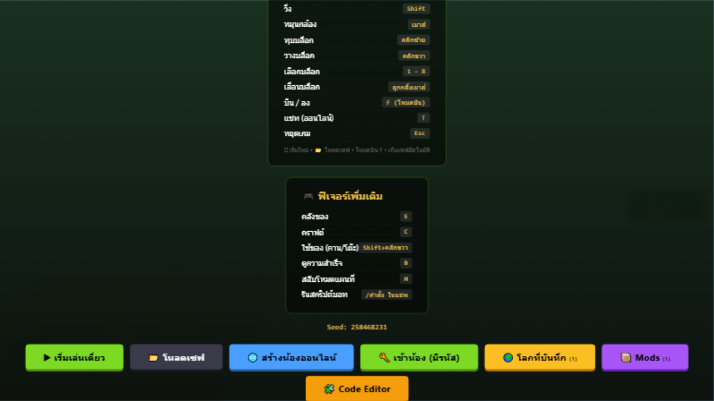

เปิดเกมมาจะเจอหน้านี้ก่อน — เลือกเล่นเดี่ยวทันที, โหลดเซฟเก่า, หรือเข้าโหมดออนไลน์ เบื้องหลังคือโลก preview ที่หมุนช้าๆ (เปิดหน้าเว็บเฉยๆ **ไม่ทับ**เซฟเก่า)

### สร้างห้องออนไลน์

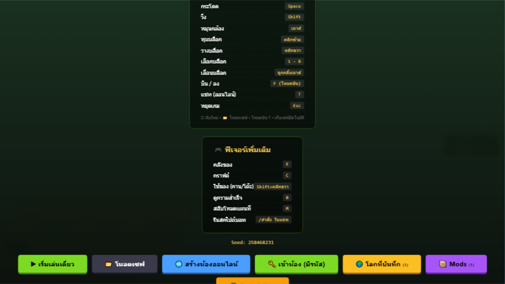

กด "🌐 สร้างห้องออนไลน์" → ตั้งชื่อ → กด "สร้างห้อง" → ได้รหัสห้อง 4 ตัวอักษรไปแชร์เพื่อน (สูงสุด 8 คน/ห้อง)

### เข้าห้องด้วยรหัส

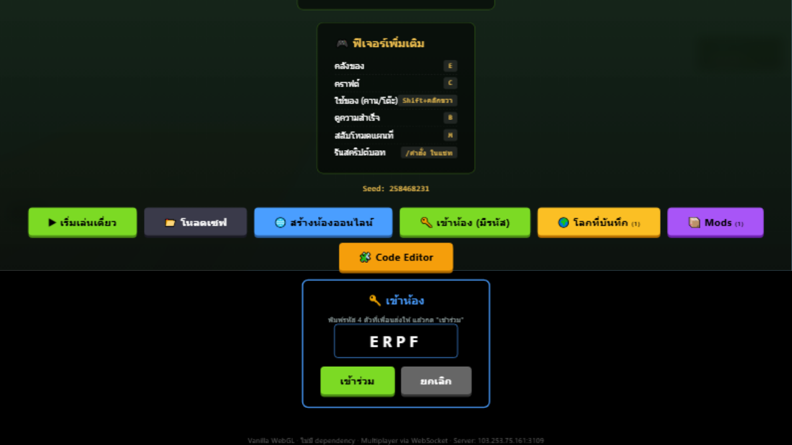

เพื่อนกด "🔑 เข้าห้อง (มีรหัส)" → กรอกรหัส (ในภาพคือ `ERPF`) → โลกของห้องโหลดเข้ามาแบบเห็นทุกอย่างที่สร้างไว้

### โลกที่บันทึกไว้บนเซิร์ฟเวอร์

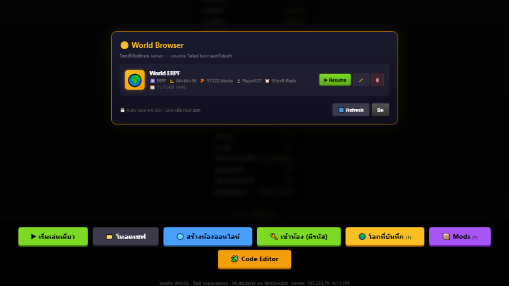

ปุ่ม "🌍 โลกที่บันทึก" แสดงรายการโลกทุกใบที่เซิร์ฟเวอร์เก็บไว้ (ชื่อ/ขนาด/จำนวนบล็อก/เวลาที่เซฟล่าสุด) — host ออกไปขนาดไหนโลกก็อยู่ต่อ กลับมาเปิดใหม่ได้เสมอ

### ตัวจัดการ Mods

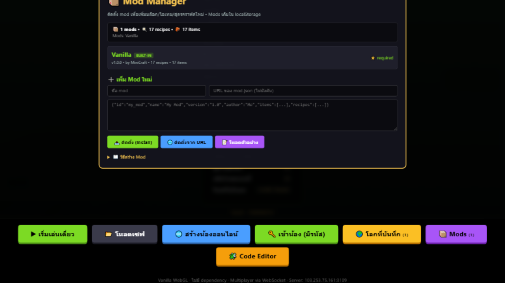

กด "📦 Mods" เพื่อติดตั้ง mod (ไอเทม+สูตรคราฟต์ใหม่) จาก JSON หรือ URL — มี Ruby Mod ตัวอย่างให้ลอง

---

## 2. พื้นฐานการเล่น

### มุมมองบุคคลที่หนึ่ง + HUD

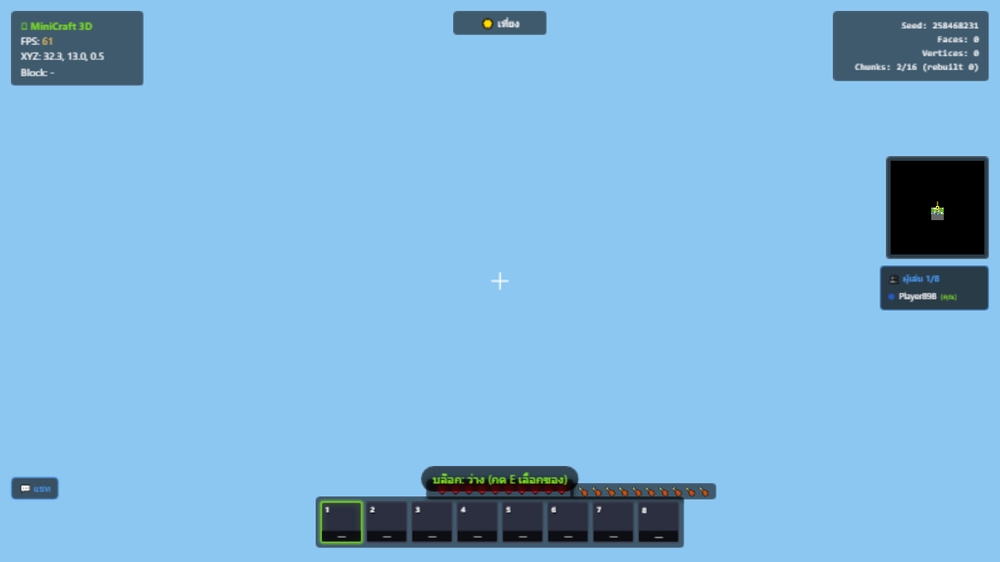

HUD ที่เห็นตลอดเวลา: ❤️ หัวใจ 10 ดวง (HP 20), 🍗 ความหิว 10 จาน, hotbar 8 ช่องด้านล่าง (ช่องมือ), แถบข้อมูลมุมซ้าย (FPS/พิกัด/บล็อกที่เล็ง/จำนวน chunk), แผนที่ย่อมุมขวาบน และจุดเล็ง (+) กลางจอ

### ทุบบล็อก

เล็งบล็อกแล้ว**คลิกซ้าย** — มีอนุภาคสีบล็อกกระเด็นตอนทุบ + เสียงตามชนิดบล็อก (จับภาพตอนอนุภาคกำลังกระเด็น)

### ของที่ทุบได้เข้ามืออัตโนมัติ

ทุบเสร็จ บล็อกที่ได้**เติมเข้าช่องมือว่างให้เอง** พร้อมตัวเลขจำนวน (x1, x2, …) — ชื่อของที่ถือแสดงด้านล่าง ("บล็อก: ทราย" ในภาพ)

### วางบล็อก

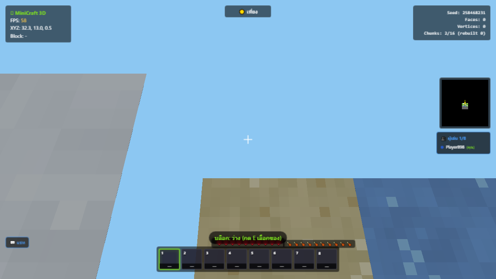

เลือกช่องมือที่ถือบล็อก (1–8) แล้ว**คลิกขวา** — บล็อกวางลงตำแหน่งที่เล็ง ในโหมดเดินจะถูกหักจากคลัง 1 ชิ้น (โหมดบินวางฟรี)

---

## 3. คลังของและคราฟต์

### คราฟต์ 2×2 (กด C)

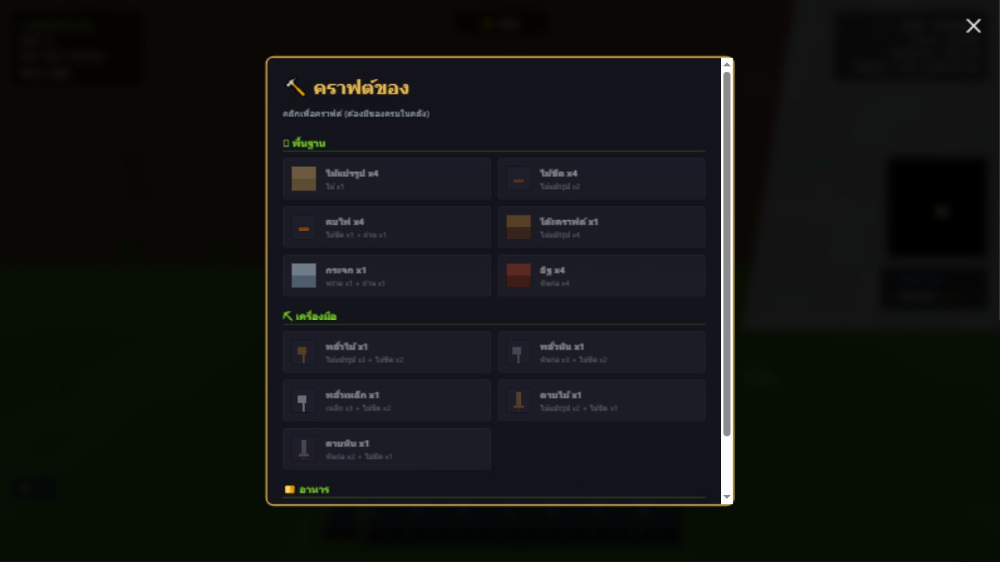

หน้าต่างคราฟต์แสดงสูตรทั้งหมดที่ทำได้ตอนนี้ แยกตามหมวด (พื้นฐาน/เครื่องมือ/ก่อสร้าง/อาหาร) — สูตรไหนมีวัตถุดิบพอจะสว่าง ไม่พอจะจางลง กดที่สูตรเพื่อคราฟต์ได้เลย

### โต๊ะคราฟต์และหีบในโลก

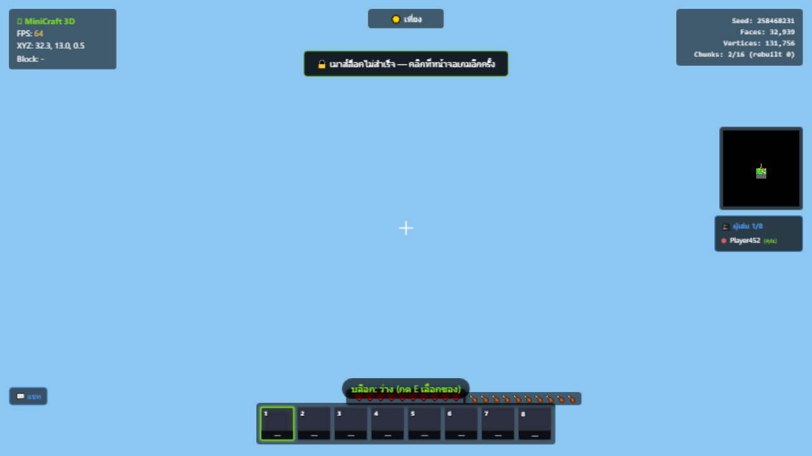

วาง**โต๊ะคราฟต์** (ไม้แปรรูป×4) และ**หีบ** (ไม้แปรรูป×9 ผ่านโต๊ะ) ลงพื้น — ใช้ Shift+คลิกขวาเพื่อเปิด

### โต๊ะคราฟต์ 3×3

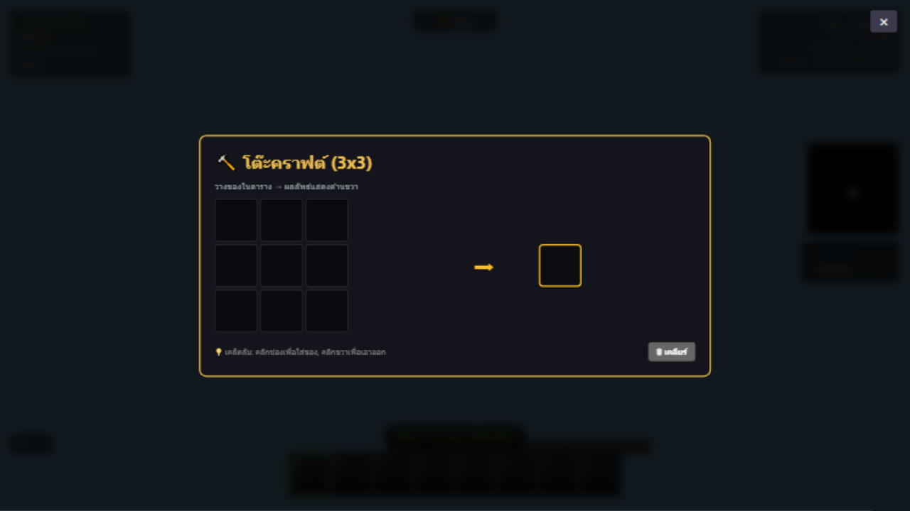

โต๊ะคราฟต์เปิดตาราง 9 ช่อง — ใส่วัตถุดิบตามรูปแบบสูตร (เช่น หีบ = ไม้ครบ 9 ช่อง, เตา = หินกรวดล้อมรอบ) สูตรหีบ/เตา/ประตูทำผ่านโต๊ะอย่างเดียว

### หีบเปิดมีของ

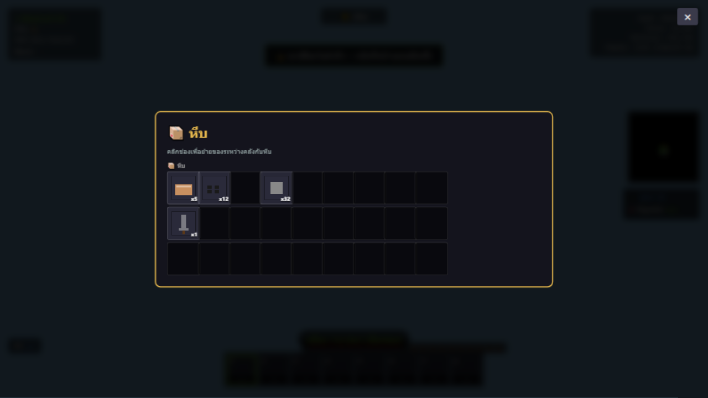

หีบมี 27 ช่อง ของที่ใส่ไว้ (ขนมปัง ถ่าน อิฐ ดาบหิน ตามภาพ) เซฟไปกับโลก — **ทุบหีบของกลับเข้าคลังทั้งหมด** ไม่หล่นหาย และในห้องออนไลน์ทุกคนแก้ร่วมกันได้

---

## 4. อาหารและความหิว

### ถืออาหารเมื่อความหิวต่ำ

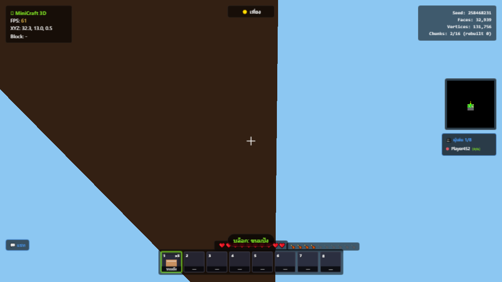

ความหิวลดลงเรื่อยๆ ตอนเดิน (ภาพนี้เหลือ 7/20 — จาน 🍗 หายไป 3 ใบ) — ถืออาหารไว้ในมือ (ภาพ: ขนมปัง +4) โดยกด E แล้วคลิกซ้ายของ

### หลังกิน

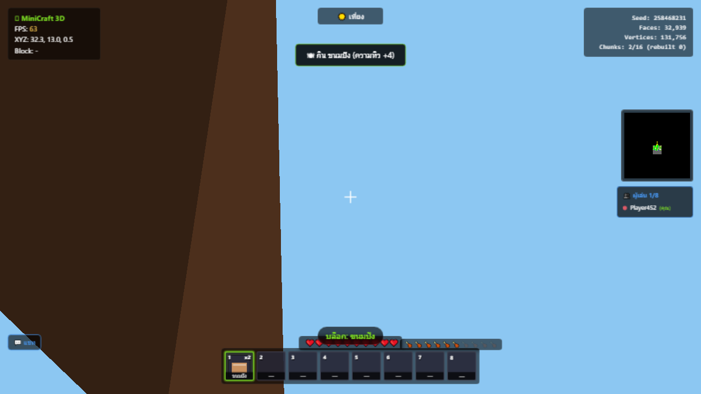

**คลิกขวาเพื่อกิน** — ความหิวเพิ่มขึ้นทันที (7 → 11 ในภาพ) ขนมปังถูกใช้ไป 1 ชิ้น · ตารางอาหาร: ขนมปัง +4, หมูดิบ +3, หมูสุก +5, เนื้อเน่า +1

---

## 5. การต่อสู้

### เล็งมอบ

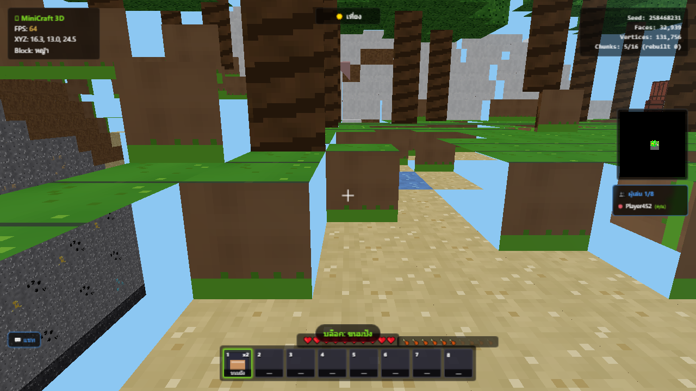

ถือดาบ (ภาพ: ดาบหิน ดาเมจ 4) แล้วเล็งม็อบใต้จุดเล็ง — ม็อบปลอดภัยอย่างหมู/วัวให้เนื้อ ส่วนซอมบี้/ครีปเปอร์ออกกลางคืน

### โจมตี

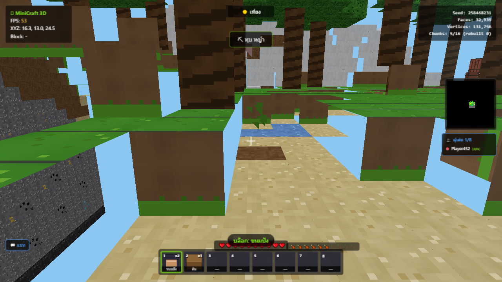

**คลิกซ้าย**เพื่อฟัน — ดาเมจตามของที่ถือ: หมัด 1 / ดาบไม้ 3 / ดาบหิน 4 — ฆ่าได้ดรอปเนื้อ (หมู) หนัง (วัว) ดินปืน (ครีปเปอร์)

---

## 6. โหมดบิน

### เปิดโหมดบิน (F)

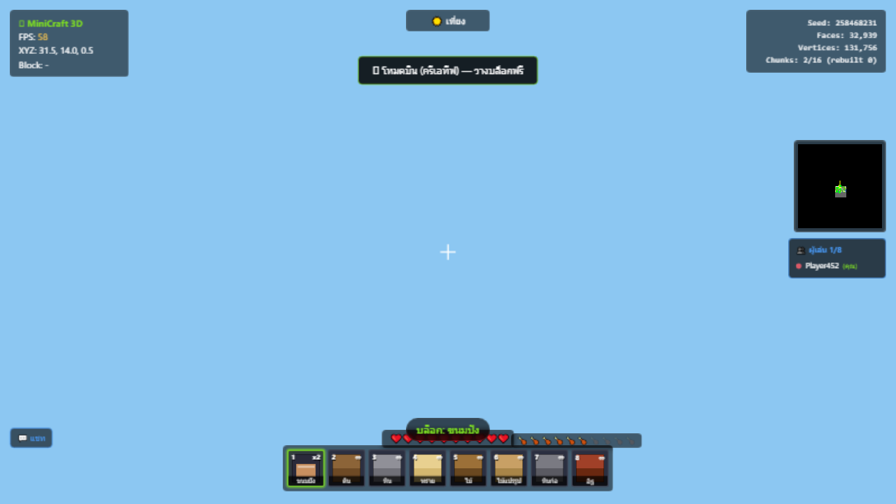

กด `F` — ช่องมือว่างถูกเติมพาเลทต์บล็อก 8 ชนิดฟรี ตัวเลขกลายเป็น `∞` ไม่หิว ไม่เจ็บตก วางบล็อกไม่หักคลัง

### มุมมองจากที่สูง

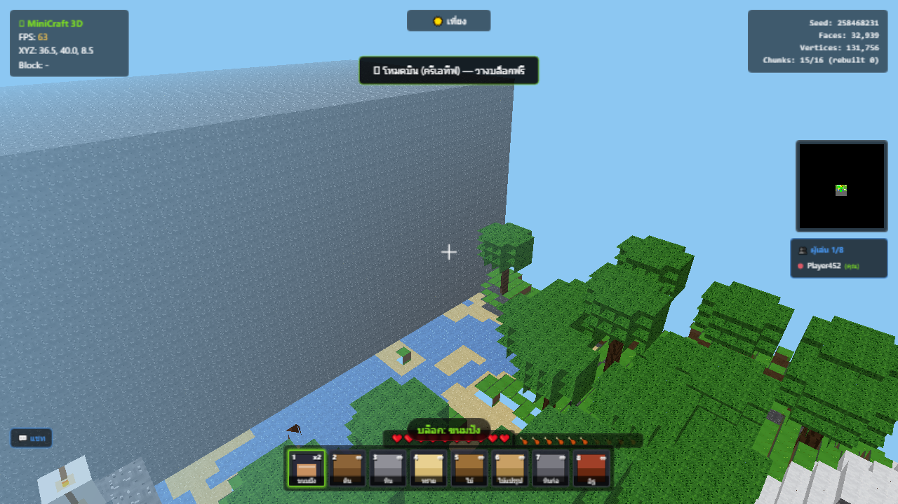

`Space` บินขึ้น / `Shift` บินลง — มุมสูงเห็นทั้งบ้านอิฐ พีระมิดบนเขา และแอ่งน้ำในมุมเดียว เหมาะกับวางแผนก่อสร้าง

---

## 7. น้ำและการดำน้ำ

### ยืนในน้ำ

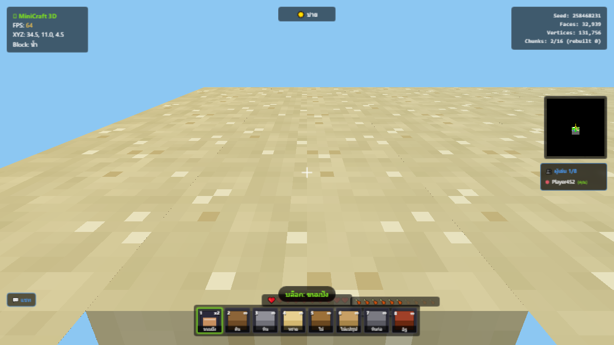

ในน้ำเคลื่อนที่ช้าลง (×0.6) จมลงช้าๆ กด `Space` ว่ายขึ้น — **ตกลงน้ำจากที่สูงไม่เจ็บ** และมีเสียง splash ตอนดำลง

### ดำน้ำ — ฟองอากาศ

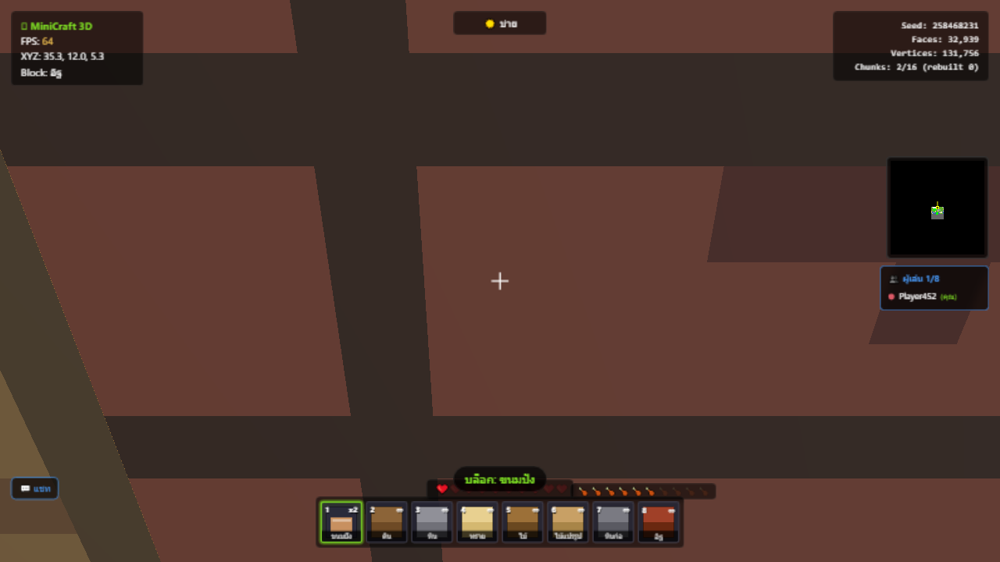

หัวอยู่ใต้น้ำ → ฟองอากาศ 🫧 เหนือ hotbar ลดลง 1 ฟอง/1.4 วินาที (ภาพถ่ายหลังจม ~2.6 วินาที ฟองเริ่มลดแล้ว) หมดแล้วเสีย HP 1/วินาที — โผล่หัวพ้นน้ำเต็มทันที · น้ำส่วนใหญ่ในโลกตื้น 1 บล็อก อยากดำให้ขุดพื้นทรายใต้น้ำเพิ่มความลึก

---

## 8. กลางวัน-กลางคืน

วันหนึ่งในเกม = 10 นาทีจริง ท้องฟ้าและแสงเปลี่ยนตาม:

### เที่ยงวัน

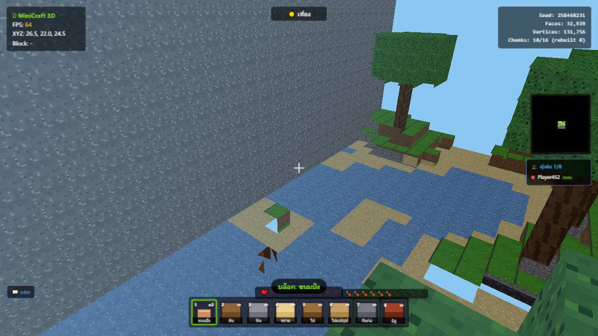

แสงเต็มที่ เห็นไกลที่สุด — ช่วงเก็บของ/สำรวจ (มอบปีศาจไม่ออก)

### พลบค่ำ

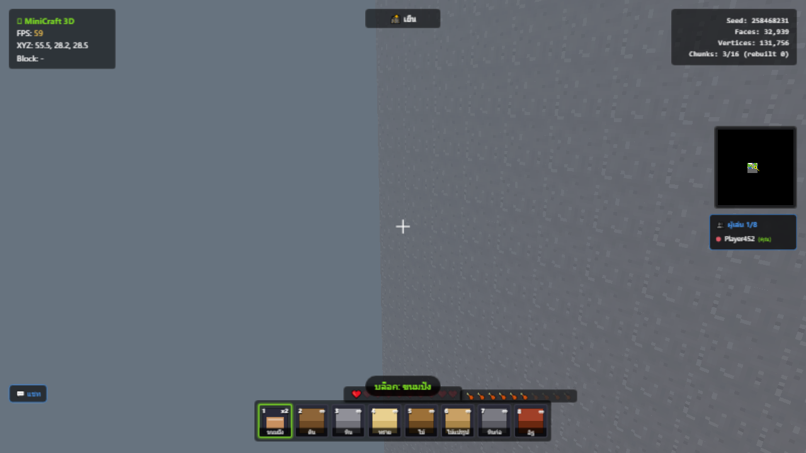

ท้องฟ้าออกส้ม — โอกาสสุดท้ายก่อนมืด รีบกลับบ้านหรือวางคบไฟ

### กลางคืน

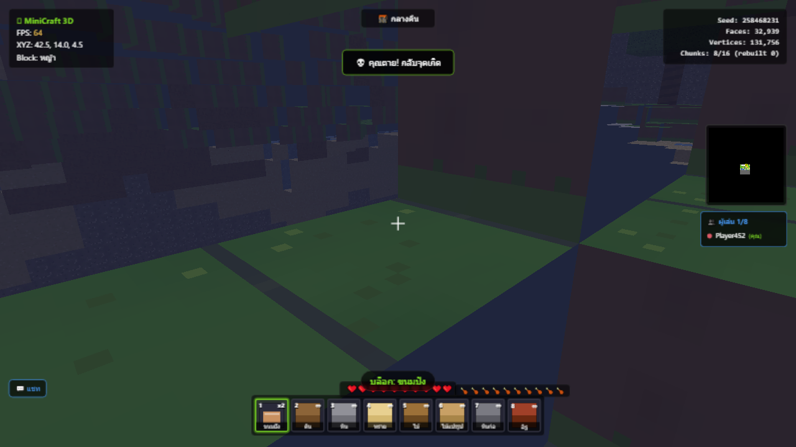

มืดและอันตราย — ซอมบี้ ครีปเปอร์ออกไล่ล่า อยู่ในบ้าน/ใต้แสงคบไฟจะปลอดภัยกว่า

### คบไฟกลางคืน

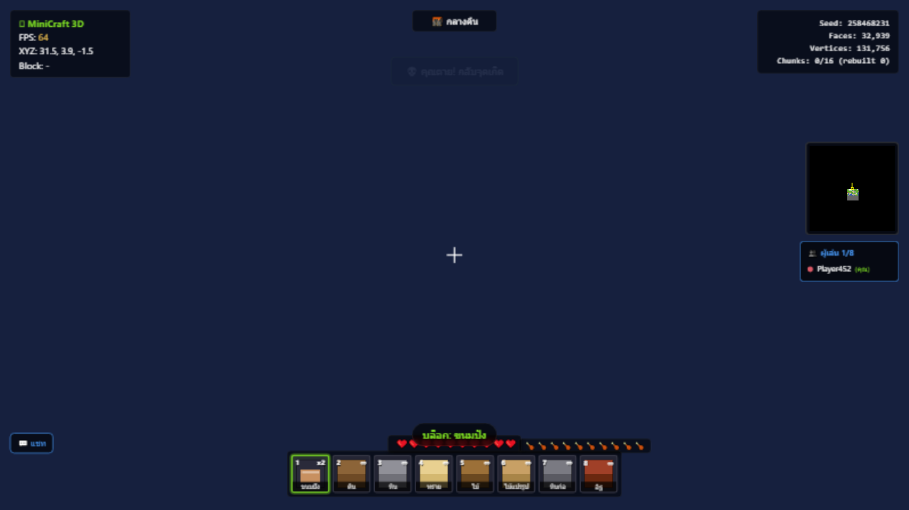

คบไฟ (ไม้ขีด+ถ่าน) วางไว้หน้าบ้าน/ในเหมือง เป็นจุดส่องแสงและหมายเลขทาง

---

## 9. เมนูพัก

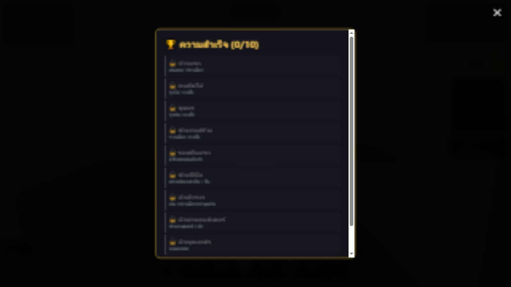

กด `Esc` — เกมหยุดชั่วคราว มีปุ่มเล่นต่อ · ปิดทุกหน้าต่างที่เปิดค้างได้ด้วยปุ่มเดียวกัน

---

## 10. Block Code Editor และบอท

### พาเลทคำสั่ง

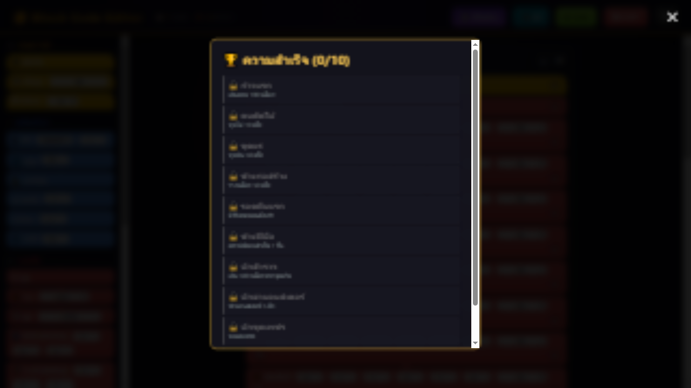

กด "🧩 Code Editor" — คำสั่งแบ่ง 5 หมวด: 📢 เหตุการณ์ (เมื่อเริ่ม/เมื่อพูด/เมื่อกด) 🚶 เคลื่อนไหว 🎬 แอคชั่น ⚙ ควบคุม 💜 ตัวแปร — ลากมาต่อกันเป็นโปรแกรมสไตล์ Scratch

### โหลดตัวอย่าง

ปุ่ม "📝 ตัวอย่าง" ใส่โปรแกรมสำเร็จรูป: บอททักทาย → วางหญ้า 5 ก้อน เดินหน้า 5 กวาด → รายงาน "เสร็จแล้ว!" — ลอง Run แล้วแก้ตัวเลขดู

### รันบอท

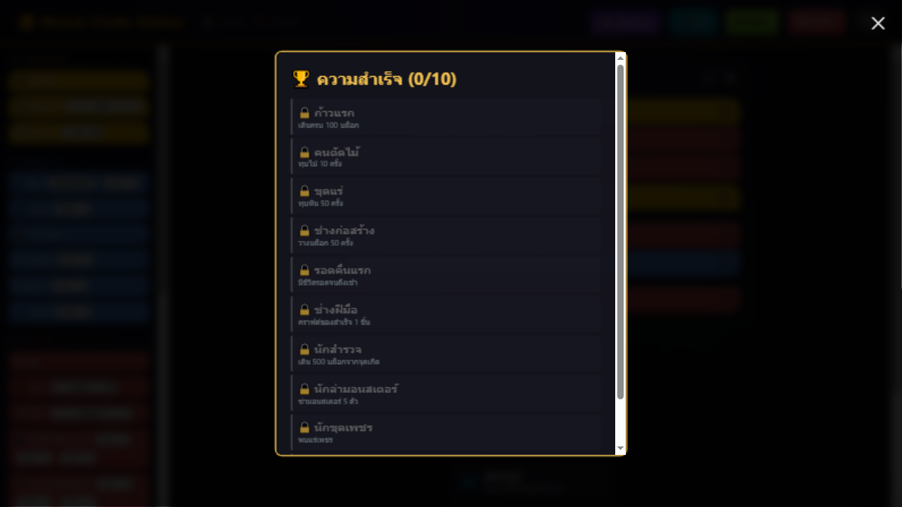

กด ▶ Run — บอทเกิดที่ตำแหน่งผู้เล่น ทำคำสั่งทีละขั้นพร้อม**ป้ายคำพูด**เหนือหัว ("สวัสดี! เริ่มสร้างบ้าน") · หยุดด้วย ⏹ Stop

---

## 11. AI Script Generator

### พิมพ์ภาษาไทย

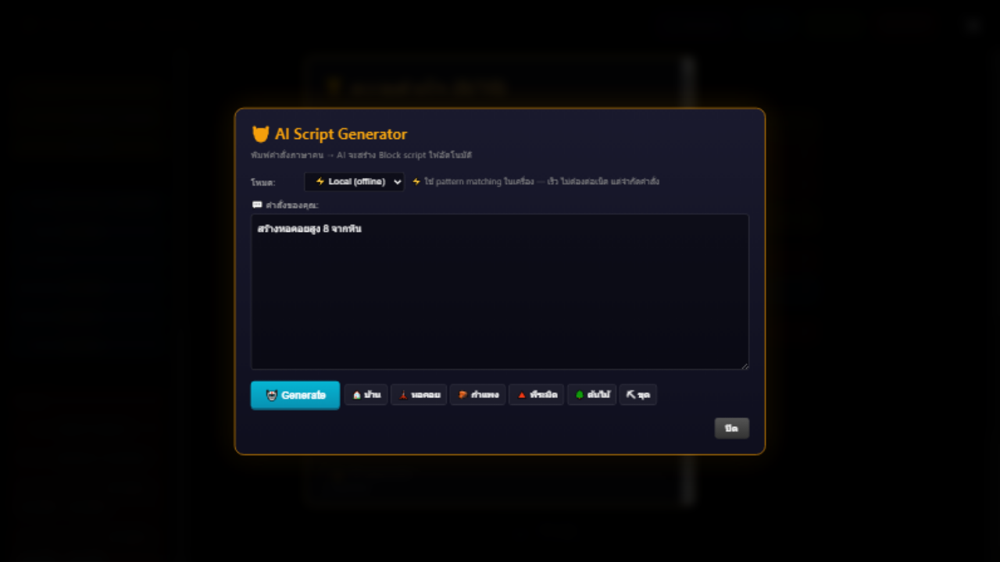

กดปุ่ม 🤖 AI ใน editor แล้วพิมพ์ความต้องการเป็น**ภาษาไทย** — ภาพนี้พิมพ์ "สร้างหอคอยสูง 8 จากหิน" (ใส่ API key ของตัวเองได้ถ้าอยากใช้ LLM จริง ไม่ใส่ก็ใช้โหมด local ออฟไลน์ได้)

### ผลลัพธ์ที่สร้างได้

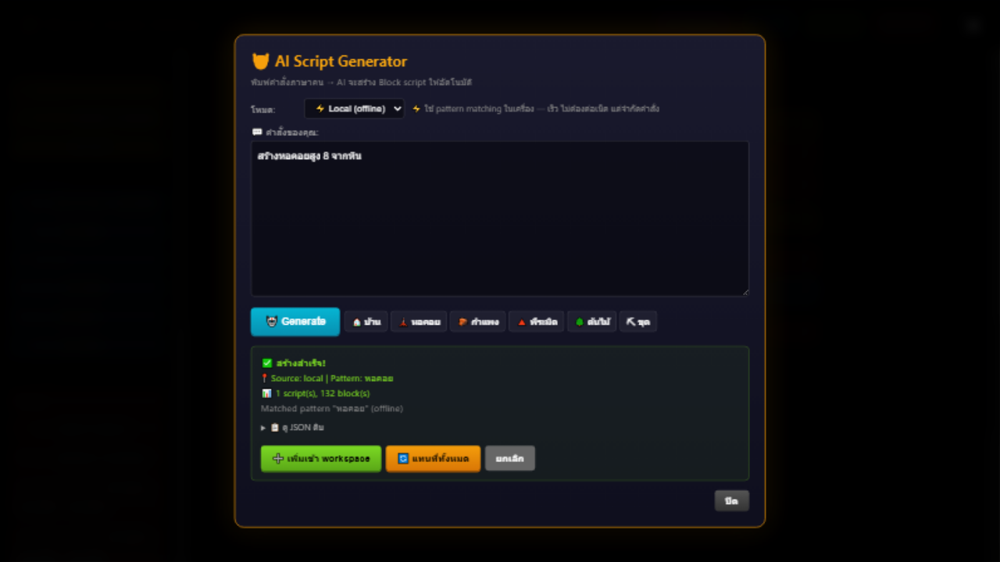

กด Generate → AI แปลงประโยคเป็นบล็อกคำสั่ง — ระบุ pattern ที่จับได้ จำนวน block และโค้ด JSON ดิบให้ตรวจ — กด "➕ เพิ่มเข้า workspace" แล้ว Run ได้เลย · รองรับ 12 แพตเทิร์น: บ้าน หอคอย กำแพง สะพาน พื้น พีระมิด สระ วงกลม ขุด เดิน ทักทาย ต้นไม้

---

## 12. ความสำเร็จ

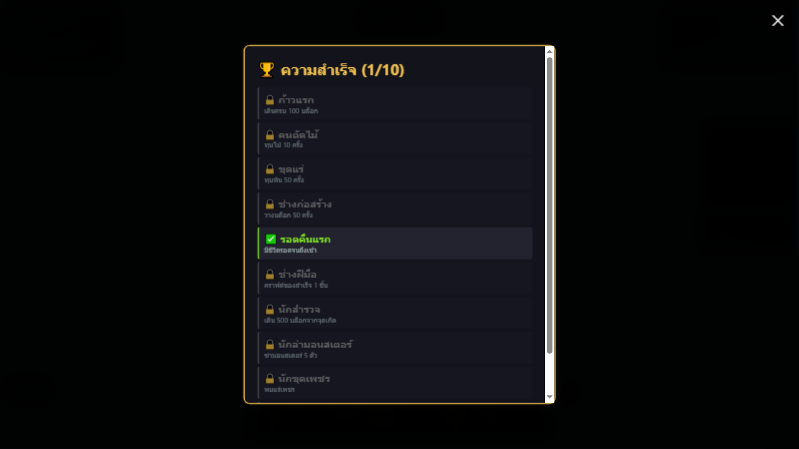

กด `B` — รายการความสำเร็จ 10 อันพร้อมเงื่อนไขและสถานะปลดล็อก (ภาคผนวกด้านล่างมีเงื่อนไขครบทุกอัน)

---

## 13. โครงสร้างในโลก

### บ้านอิฐที่ AI สร้าง

ผลงานจริงจากคำสั่ง "สร้างบ้าน 5x5 จากอิฐ" — กำแพง 3 ชั้น 44 อิฐ ช่องประตู หน้าต่างกระจก · บ้านนี้ถูกเก็บบนเซิร์ฟเวอร์ ปิดเบราว์เซอร์ไปก็ยังอยู่เวลากลับมา

### ยอดพีระมิด

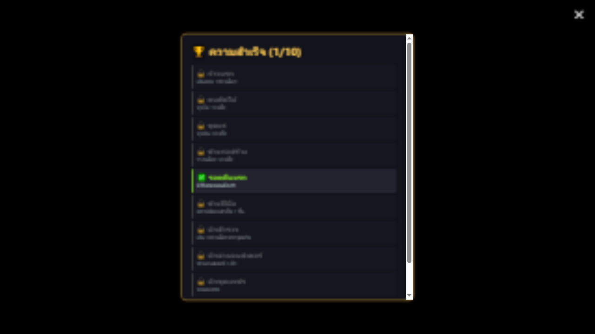

พีระมิดหิน 4 ชั้นบนยอดเขา (ฐาน 9×9 ถึงยอดกลอสโตน) สร้างโดยถมแท่น 815 บล็อกก่อน — มุมนี้ยืนบนยอดกลอสโตนมองลงไปที่บ้าน

---

## ภาคผนวก: ตารางอ้างรวดเร็ว

| ปุ่ม | การทำงาน | ปุ่ม | การทำงาน |
|---|---|---|---|
| `WASD` | เดิน | `E` | คลังของ |
| `Shift` | วิ่ง / บินลง | `C` | คราฟต์ 2×2 |
| `Space` | กระโดด / ว่าย / บินขึ้น | `Shift+คลิกขวา` | ใช้โต๊ะ/หีบ/คาน |
| คลิกซ้าย | ทุบ / ตีมอบ | `B` | ความสำเร็จ |
| คลิกขวา | วาง / กิน | `M` | สลับแผนที่ย่อ |
| `1–8` / ลูกกลิ้ง | เลือกช่องมือ | `F` | โหมดบิน |
| `T` | แชท (`/cmd` สั่งบอท) | `P` | เซฟทันที |
| `Esc` | ปิดหน้าต่าง / พัก | `R` | โลกใหม่ (ยืนยัน) |

**อาหาร:** ขนมปัง +4 · หมูดิบ +3 · หมูสุก +5 · เนื้อเน่า +1  |  **ดาเมจ:** หมัด 1 · ดาบไม้ 3 · ดาบหิน/mod 4  |  **อากาศ:** 10 ฟอง × 1.4 วิ หมดแล้ว −1 HP/วิ

> รายละเอียดเต็มของทุกหัวข้อ (สูตรคราฟต์ครบ, opcode ทั้งหมด, โหมดออนไลน์, PWA, FAQ) อยู่ที่ [GAMEPLAY.md](GAMEPLAY.md)

---

*ภาพทั้งหมดถ่ายจากเกมรันสด (ตุลาคม 2026) ในเซสชันอัตโนมัติบนเซิร์ฟเวอร์จริง — ตรวจสอบสถานะเกม ณ ขณะถ่ายทุกภาพ และคัดกรองภาพซ้ำออกก่อนรวมเล่ม (34 ภาพ ไม่มีภาพซ้ำ)*
